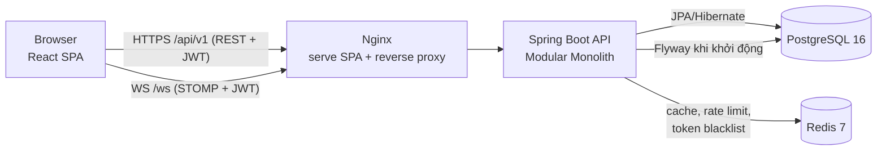
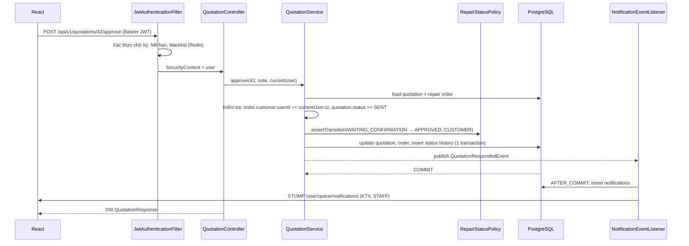

# RepairFlow – Kiến trúc hệ thống

## 1. Tổng quan



- **Một repo, 2 ứng dụng**: `backend/` (Spring Boot) và `frontend/` (React + Vite).
- Dev: Vite dev server (5173) **proxy** `/api` và `/ws` sang `localhost:8080` → trình duyệt thấy cùng origin, cookie refresh token hoạt động mà không cần nới lỏng cookie. CORS vẫn được cấu hình (danh sách origin từ biến môi trường) cho trường hợp gọi trực tiếp.
- Production (Docker Compose): Nginx phục vụ file tĩnh build của React và proxy `/api`, `/ws` sang container backend.

## 2. Backend – Modular Monolith theo feature

Lý do chọn: dự án một nhóm nhỏ, một DB → microservices là thừa; nhưng chia **theo module nghiệp vụ** (thay vì một thư mục `controller/` khổng lồ) giúp mỗi module tự chứa, dễ đọc, dễ tách sau này.

```
backend/src/main/java/com/repairflow/
├── RepairFlowApplication.java
├── common/            # dùng chung, KHÔNG chứa nghiệp vụ
│   ├── exception/     # BusinessException, NotFoundException, ConflictException, GlobalExceptionHandler, ErrorCode
│   ├── web/           # PageResponse, ApiErrorResponse
│   ├── audit/         # BaseEntity (createdAt, updatedAt), AuditLog, AuditService
│   └── util/          # CodeGenerator (sequence → mã)
├── config/            # OpenApiConfig, RedisConfig, CacheConfig, WebSocketConfig, JpaConfig, CorsProperties
├── security/          # SecurityConfig, JwtService, JwtAuthenticationFilter, CurrentUser, RestAuthEntryPoint, RestAccessDeniedHandler, RateLimiter
├── auth/              # AuthController, AuthService, RefreshTokenService, PasswordResetService, dto/
├── user/              # User entity, Role, UserRepository, UserService, UserController (admin), dto/, UserMapper
├── customer/          # controller / service / repository / entity / dto / mapper
├── device/
├── repair/            # RepairRequest*, RepairOrder*, RepairStatusPolicy (máy trạng thái), RepairStatusHistory
├── quotation/
├── inventory/         # Part, InventoryTransaction, InventoryService (pessimistic lock)
├── warranty/
├── notification/      # Notification entity, NotificationService, NotificationEventListener, WebSocket push
└── dashboard/         # DashboardService (truy vấn tổng hợp, cache Redis), ReportController
```

Mỗi module có cấu trúc giống nhau:

| Tầng | Trách nhiệm | Không được làm |
|---|---|---|
| `*Controller` | Nhận HTTP, `@Valid` DTO, gọi service, trả `ResponseEntity<DTO>` | Chứa logic nghiệp vụ, gọi repository trực tiếp |
| `*Service` | Nghiệp vụ, `@Transactional`, kiểm tra quyền sở hữu tài nguyên, phát event | Biết về HTTP (request/response) |
| `*Repository` | Spring Data JPA, query tùy chỉnh (`@Query`, Specification cho filter) | Chứa logic |
| `entity` | Mapping bảng, invariant đơn giản (VD `Part.decreaseStock()` ném lỗi khi thiếu) | Bị trả ra Controller |
| `dto` | `record` Java cho Request/Response, annotation validation | — |
| `*Mapper` | Chuyển Entity ↔ DTO (viết tay, static method) | — |

### Luồng một request ghi (ví dụ đồng ý báo giá)



### Phân quyền 2 lớp
1. **RBAC ở tầng URL/method**: `@PreAuthorize("hasAnyRole('ADMIN','STAFF')")` trên controller method.
2. **Resource-based ở Service**: các truy vấn của CUSTOMER luôn kèm điều kiện `customer.user.id = :currentUserId`; TECHNICIAN chỉ thao tác phiếu `technician.id = :currentUserId`. Không tìm thấy trong phạm vi → `404` (không lộ sự tồn tại); thấy nhưng không có quyền thao tác → `403`.

### Xử lý lỗi thống nhất
Mọi lỗi trả về cùng một format (xem `api-specification.md` §1.4), do `GlobalExceptionHandler` (`@RestControllerAdvice`) xử lý; 401/403 ở tầng filter do `RestAuthEntryPoint` / `RestAccessDeniedHandler` trả JSON cùng format.

## 3. Bảo mật – vòng đời token

```mermaid
sequenceDiagram
    participant FE as React (Redux: accessToken trong RAM)
    participant API as Backend
    FE->>API: POST /auth/login {email, password}
    API-->>FE: 200 {accessToken, user} + Set-Cookie: rf_refresh=...; HttpOnly; SameSite=Strict; Path=/api/v1/auth
    FE->>API: GET /repair-orders (Authorization: Bearer access)
    API-->>FE: 401 TOKEN_EXPIRED (sau 15 phút)
    FE->>API: POST /auth/refresh (cookie tự gửi)
    API->>API: hash(cookie) → tìm token, còn hạn & chưa thu hồi → thu hồi, cấp token mới cùng family
    API-->>FE: 200 {accessToken} + Set-Cookie mới
    FE->>API: Gửi lại request ban đầu
    Note over FE,API: F5 trang: Redux mất token → app gọi /auth/refresh khi khởi động để khôi phục phiên
```

- Axios interceptor dùng **một promise refresh dùng chung**: nhiều request cùng nhận 401 chỉ gọi refresh 1 lần, các request khác chờ rồi retry.
- Refresh thất bại → xóa state, chuyển `/login`.
- Vì sao access token không để localStorage? XSS có thể đọc localStorage. Giữ trong RAM + refresh token HttpOnly (JS không đọc được) giảm thiệt hại khi có XSS.
- CSRF: endpoint duy nhất dùng cookie là `/auth/refresh` và `/auth/logout`; cookie `SameSite=Strict` + giới hạn `Path` → trang web khác không thể kích hoạt. API còn lại dùng header Bearer nên không bị CSRF → tắt CSRF của Spring Security (stateless).

## 4. Redis – dùng cho gì

| Mục đích | Key | TTL | Invalidation |
|---|---|---|---|
| Cache dashboard theo role | `dashboard::{role}:{userId?}` | 60s | `@CacheEvict` khi phiếu đổi trạng thái / giao dịch kho |
| Cache danh mục linh kiện (danh sách cho Select) | `parts::active` | 10 phút | Evict khi tạo/sửa/ngừng linh kiện (tồn kho **không** cache – luôn đọc DB) |
| Blacklist access token sau logout | `jwt:blacklist:{jti}` | = thời gian còn lại của token | Tự hết hạn |
| Rate limit đăng nhập | `rl:login:{email}` | 15 phút | Xóa khi đăng nhập thành công |
| Rate limit tra cứu BH công khai | `rl:warranty:{ip}` | 1 phút | Tự hết hạn |

**Không cache**: thông tin người dùng/mật khẩu, refresh token, tồn kho (cần chính xác tuyệt đối), dữ liệu cá nhân khách hàng.
Nếu Redis không kết nối được: cache tự bỏ qua (`CacheErrorHandler` log cảnh báo) để hệ thống vẫn chạy; riêng blacklist/rate limit fail-open có log (đánh đổi tính khả dụng – ghi trong TECHNICAL_DECISIONS).

## 5. WebSocket

- Endpoint STOMP `/ws` (SockJS không cần – trình duyệt hiện đại hỗ trợ WebSocket gốc).
- Client gửi `Authorization: Bearer <token>` trong header của frame `CONNECT`; `ChannelInterceptor` xác thực và gán `Principal = userId`.
- Server đẩy bằng `SimpMessagingTemplate.convertAndSendToUser(userId, "/queue/notifications", dto)`.
- Simple in-memory broker (1 instance). Nếu scale nhiều instance → chuyển sang Redis pub/sub hoặc broker relay (ghi chú mở rộng).

## 6. Testing

| Loại | Công cụ | Phạm vi |
|---|---|---|
| Unit | JUnit 5 + Mockito | `RepairStatusPolicy` (mọi chuyển đổi hợp lệ/không hợp lệ), tính tiền báo giá, `InventoryService` (thiếu tồn), `JwtService` |
| Web slice | `@WebMvcTest` + `spring-security-test` | Validation 400, 401/403 theo role |
| Integration | `@SpringBootTest` + **Testcontainers** (PostgreSQL, Redis thật) | Flyway migrate, luồng end-to-end tiếp nhận → bàn giao, xuất kho đồng thời (2 thread) không âm kho, CUSTOMER không đọc được phiếu người khác |
| Frontend | Vitest + React Testing Library + MSW | Form login/validation, RoleGuard, interceptor refresh token, StatusTag |

Testcontainers cần Docker đang chạy khi chạy integration test.

## 7. Triển khai

`docker-compose.yml`: `postgres` (volume), `redis`, `backend` (multi-stage Maven → JRE 17 Alpine, healthcheck `/actuator/health`), `frontend` (multi-stage Node build → Nginx). Biến môi trường từ `.env` (copy từ `.env.example`).
