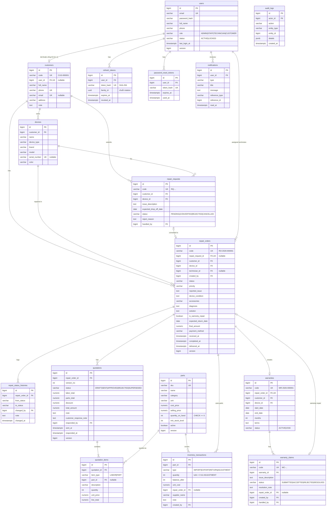

# RepairFlow – Thiết kế cơ sở dữ liệu & ERD (Phase 2)

> PostgreSQL 16 · Migration: Flyway · Phiên bản: 0.2 – đã hiện thực ở `backend/src/main/resources/db/migration` (Mốc 2)
>
> Thay đổi so với 0.1: khóa ngoại yêu cầu online ↔ phiếu đặt ở `repair_orders.repair_request_id` (UNIQUE) thay vì `repair_requests.repair_order_id` – một chiều duy nhất, tránh FK vòng giữa hai bảng.

## 1. Nguyên tắc thiết kế

- Khóa chính `BIGINT GENERATED ALWAYS AS IDENTITY` (nhanh, đơn giản, Hibernate dùng `GenerationType.IDENTITY`).
- Mã nghiệp vụ hiển thị cho người dùng (`RO-2026-000123`) tách khỏi khóa chính, sinh từ **sequence** PostgreSQL → không trùng khi tạo đồng thời.
- Tiền: `NUMERIC(15,2)` ↔ Java `BigDecimal`. Không dùng `float/double`.
- Enum lưu `VARCHAR` + `CHECK` (đọc được khi query trực tiếp, thêm giá trị chỉ cần sửa CHECK; tránh kiểu `ENUM` của Postgres khó migrate).
- Thời gian: `TIMESTAMPTZ` (lưu UTC), ngày thuần: `DATE`.
- FK mặc định `ON DELETE RESTRICT` – không xóa dây chuyền dữ liệu nghiệp vụ. Chỉ bảng phụ thuần (`quotation_items`, `refresh_tokens`) dùng `CASCADE`.
- Cột `version BIGINT` cho optimistic locking ở các bảng hay bị cập nhật đồng thời.
- Tìm kiếm không phân biệt hoa thường: index trên `lower(col)`; email lưu dạng lowercase.

## 2. ERD



> Tất cả bảng nghiệp vụ có thêm `created_at`, `updated_at` (không vẽ để ERD gọn).

## 3. Mô tả bảng & ràng buộc quan trọng

### users
| Cột | Kiểu | Ràng buộc |
|---|---|---|
| email | VARCHAR(255) | NOT NULL, UNIQUE (lưu lowercase) |
| password_hash | VARCHAR(100) | NOT NULL (BCrypt 60 ký tự) |
| role | VARCHAR(20) | CHECK IN ('ADMIN','STAFF','TECHNICIAN','CUSTOMER') |
| status | VARCHAR(20) | CHECK IN ('ACTIVE','LOCKED'), default ACTIVE |

Index: `idx_users_role_status (role, status)`.

### refresh_tokens
- Chỉ lưu `token_hash = SHA-256(token)` → lộ DB cũng không dùng được token.
- `family_id`: mọi token sinh ra từ cùng một lần đăng nhập chung family. Phát hiện token đã thu hồi bị dùng lại → thu hồi cả family (dấu hiệu bị đánh cắp).
- Index: `(user_id)`, `(family_id)`. Job dọn token hết hạn (scheduled) chạy hằng ngày.

### customers
- `phone` UNIQUE NOT NULL; `email` UNIQUE khi khác NULL (Postgres cho phép nhiều NULL trong UNIQUE).
- `user_id` UNIQUE nullable → quan hệ 1–0..1 với `users`.
- Index tìm kiếm: `lower(full_name)` dùng `pg_trgm` GIN để `ILIKE '%...%'` nhanh.

### devices
- `serial_number` UNIQUE (partial index `WHERE serial_number IS NOT NULL`, trên `upper(serial_number)`).
- Index `(customer_id)`.

### repair_orders
- `status` CHECK 10 giá trị: `RECEIVED, INSPECTING, WAITING_CONFIRMATION, APPROVED, REJECTED, WAITING_FOR_PARTS, REPAIRING, COMPLETED, DELIVERED, CANCELLED`.
- `priority` CHECK IN ('LOW','NORMAL','HIGH','URGENT').
- `payment_method` CHECK IN ('CASH','BANK_TRANSFER','CARD') nullable.
- `final_amount NUMERIC(15,2) CHECK (final_amount >= 0)`.
- Index: `(status)`, `(technician_id, status)`, `(customer_id)`, `(device_id)`, `(delivered_at)` cho báo cáo doanh thu, `(created_at DESC)` cho danh sách.
- **Máy trạng thái không nằm trong DB** (trigger khó test, khó giải thích) mà trong Service Java (`RepairStatusPolicy`) – có unit test bao phủ.

### quotations / quotation_items
- `UNIQUE (repair_order_id, version_no)`.
- Partial unique index: `UNIQUE (repair_order_id) WHERE status = 'SENT'` → DB đảm bảo tối đa 1 báo giá đang chờ khách.
- `quotation_items.quantity > 0`, `unit_price >= 0`; `item_type='PART'` ⇒ `part_id NOT NULL` (CHECK).
- `ON DELETE CASCADE` từ quotation → items (chỉ xóa được báo giá DRAFT).

### parts / inventory_transactions
- `parts.quantity_on_hand INT NOT NULL CHECK (quantity_on_hand >= 0)` – chốt chặn cuối chống âm kho.
- Tồn kho được cập nhật **cùng transaction** với việc ghi `inventory_transactions` → luôn đối soát được: tồn hiện tại = `balance_after` của giao dịch mới nhất.
- `type='EXPORT'` ⇒ `repair_order_id NOT NULL` (CHECK).
- Index: `(part_id, created_at DESC)`, `(repair_order_id)`, `(type, created_at)`.

### warranties / warranty_claims
- `warranties.repair_order_id` UNIQUE (mỗi phiếu tối đa 1 bảo hành). `CHECK (end_date >= start_date)`.
- "Còn hạn" được **tính** (`status='ACTIVE' AND end_date >= CURRENT_DATE`) – không cần job cập nhật trạng thái EXPIRED.
- `warranty_claims.repair_order_id` UNIQUE nullable.

### notifications
- Index `(user_id, read_at, created_at DESC)` → đếm chưa đọc + danh sách nhanh.

### audit_logs
- `details JSONB` lưu dữ liệu trước/sau của thao tác quản trị (đổi vai trò, khóa tài khoản, điều chỉnh kho …).

## 4. Sequence sinh mã

| Sequence | Định dạng |
|---|---|
| `customer_code_seq` | `CUS-000001` |
| `repair_request_code_seq` | `RQ-2026-000001` |
| `repair_order_code_seq` | `RO-2026-000001` |
| `warranty_code_seq` | `WR-2026-000001` |
| `warranty_claim_code_seq` | `WC-2026-000001` |

(Năm lấy theo thời điểm tạo; sequence không reset theo năm – đơn giản và luôn duy nhất.)

## 5. Kế hoạch migration Flyway

| File | Nội dung |
|---|---|
| `V1__init_auth.sql` | users, refresh_tokens, password_reset_tokens, audit_logs |
| `V2__customers_devices.sql` | customers, devices, extension pg_trgm, sequences |
| `V3__repair.sql` | repair_requests, repair_orders, repair_status_histories |
| `V4__quotation_inventory.sql` | parts, quotations, quotation_items, inventory_transactions |
| `V5__warranty.sql` | warranties, warranty_claims |
| `V6__notifications.sql` | notifications |

Dữ liệu mẫu (demo) **không** nằm trong migration production; được nạp bởi một `DemoDataSeeder` chỉ chạy ở profile `dev`, mật khẩu lấy từ biến môi trường.

## 6. Kịch bản đồng thời khi xuất kho (giải thích phỏng vấn)

Hai KTV cùng xuất linh kiện X (tồn 1), mỗi người xuất 1:

```
T1: BEGIN; SELECT * FROM parts WHERE id=X FOR UPDATE;   -- khóa dòng, đọc tồn = 1
T2: BEGIN; SELECT * FROM parts WHERE id=X FOR UPDATE;   -- BỊ CHẶN chờ T1
T1: UPDATE parts SET quantity_on_hand = 0; INSERT inventory_transactions(...); COMMIT;
T2: (được chạy tiếp) đọc tồn = 0 → 0 < 1 → ném InsufficientStockException → ROLLBACK → HTTP 409
```

Vì sao không chỉ dùng optimistic lock (`@Version`)? Với tồn kho, xung đột xảy ra thường xuyên ở linh kiện phổ biến; optimistic lock buộc client retry. Pessimistic lock ngắn (chỉ trong 1 transaction nhỏ) đơn giản và đúng. `CHECK (>= 0)` là lớp bảo vệ thứ hai nếu có code nào bỏ qua service.
