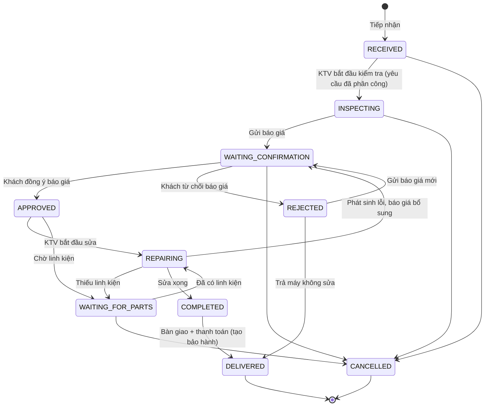

# RepairFlow – Phân tích nghiệp vụ (Phase 1)

> Phiên bản: 0.1 (bản đề xuất, chờ thống nhất) · Cập nhật: 2026-11-12

## 1. Bối cảnh

Một trung tâm sửa chữa thiết bị điện tử (điện thoại, laptop, máy tính bảng, …) đang quản lý phiếu sửa chữa bằng giấy/Excel. Các vấn đề thường gặp:

- Không biết máy của khách đang ở bước nào, ai đang sửa.
- Báo giá qua điện thoại, không có bằng chứng khách đã đồng ý.
- Linh kiện xuất kho không ghi nhận theo phiếu, tồn kho lệch.
- Khách quay lại bảo hành nhưng không tra được ngày sửa, đã thay linh kiện gì.

**RepairFlow** số hóa toàn bộ vòng đời: *tiếp nhận → kiểm tra → báo giá → sửa chữa → bàn giao → bảo hành*.

## 2. Tác nhân (Actors) và vai trò

| Vai trò | Mô tả | Phạm vi dữ liệu |
|---|---|---|
| **ADMIN** | Chủ cửa hàng / quản lý | Toàn bộ hệ thống, quản lý tài khoản nhân viên, báo cáo doanh thu |
| **STAFF** | Nhân viên quầy tiếp nhận | Khách hàng, thiết bị, phiếu sửa chữa, báo giá, bàn giao, bảo hành |
| **TECHNICIAN** | Kỹ thuật viên | **Chỉ** các phiếu được phân công cho mình: chẩn đoán, cập nhật trạng thái, dùng linh kiện |
| **CUSTOMER** | Khách hàng có tài khoản | **Chỉ** dữ liệu của chính mình: thiết bị, phiếu, báo giá, bảo hành, thông báo |

> Nguyên tắc: phân quyền **RBAC** (theo vai trò) + **resource-based** (theo quyền sở hữu tài nguyên). Ví dụ: CUSTOMER gọi `GET /repair-orders/15` của người khác → `404` (không tiết lộ tài nguyên tồn tại); TECHNICIAN cập nhật phiếu không được giao → `403`.

## 3. Các module chức năng

### 3.1 Xác thực & phân quyền (AUTH)

| ID | Yêu cầu | Ghi chú nghiệp vụ |
|---|---|---|
| AUTH-01 | Đăng nhập bằng email + mật khẩu | Trả Access Token (JWT, 15 phút) + Refresh Token (cookie HttpOnly, 7 ngày) |
| AUTH-02 | Khách hàng tự đăng ký | Tạo `user` (CUSTOMER) + hồ sơ `customer`. Nếu SĐT đã có hồ sơ tại cửa hàng → báo liên hệ nhân viên để kích hoạt (tránh chiếm hồ sơ người khác) |
| AUTH-03 | Làm mới Access Token | Refresh token **xoay vòng** (rotation): mỗi lần refresh cấp token mới, thu hồi token cũ. Dùng lại token đã thu hồi → thu hồi toàn bộ phiên của user (reuse detection) |
| AUTH-04 | Đăng xuất | Thu hồi refresh token, đưa `jti` của access token vào blacklist Redis tới khi hết hạn |
| AUTH-05 | Quên mật khẩu | Sinh token reset một lần, hết hạn 30 phút. Môi trường dev: ghi link ra log (chưa có SMTP) |
| AUTH-06 | Đổi mật khẩu, cập nhật hồ sơ cá nhân | Đổi mật khẩu → thu hồi toàn bộ refresh token |
| AUTH-07 | Khóa/mở khóa tài khoản (ADMIN) | Tài khoản bị khóa không đăng nhập/refresh được |
| AUTH-08 | Chống brute-force | Giới hạn 5 lần đăng nhập sai / 15 phút / email (Redis) |

### 3.2 Quản lý tài khoản & nhân sự (USER) – ADMIN

- Tạo tài khoản STAFF/TECHNICIAN/ADMIN, sửa thông tin, đổi vai trò, khóa/mở khóa, đặt lại mật khẩu.
- Danh sách có phân trang, lọc theo vai trò, trạng thái, tìm theo tên/email.
- Không cho ADMIN tự khóa hoặc tự hạ quyền chính mình (tránh mất quyền quản trị cuối cùng).

### 3.3 Khách hàng (CUSTOMER)

| ID | Yêu cầu |
|---|---|
| CUS-01 | CRUD khách hàng (STAFF, ADMIN). Mã tự sinh `CUS-000123` |
| CUS-02 | Tìm kiếm theo tên, SĐT, email, mã (không phân biệt hoa thường) |
| CUS-03 | Xem lịch sử sửa chữa, danh sách thiết bị của khách |
| CUS-04 | Kích hoạt tài khoản cổng khách hàng cho hồ sơ có sẵn (STAFF đặt email + mật khẩu ban đầu tại quầy) |
| CUS-05 | Chỉ xóa được khách chưa có phiếu sửa chữa; nếu đã có → `409 Conflict` |

Ràng buộc: SĐT là duy nhất (định danh chính ở cửa hàng); email tùy chọn nhưng duy nhất nếu có.

### 3.4 Thiết bị (DEVICE)

- Một khách hàng có nhiều thiết bị; một thiết bị thuộc đúng một khách.
- Thuộc tính: tên, loại (`PHONE, LAPTOP, TABLET, DESKTOP, SMARTWATCH, OTHER`), thương hiệu, model, serial/IMEI, màu, ghi chú.
- Serial number duy nhất (khi có giá trị) để tra cứu bảo hành.
- Xem lịch sử sửa chữa của thiết bị.
- CUSTOMER xem/thêm thiết bị của mình (để gửi yêu cầu sửa chữa online).

### 3.5 Yêu cầu sửa chữa & phiếu sửa chữa (REPAIR)

**Hai luồng tạo phiếu:**

1. **Online**: CUSTOMER tạo *yêu cầu sửa chữa* (`repair_request`: thiết bị, mô tả lỗi, ngày dự kiến mang máy tới). STAFF xem yêu cầu → khi khách mang máy tới thì **tiếp nhận**, chuyển yêu cầu thành phiếu sửa chữa (`RECEIVED`).
2. **Tại quầy (walk-in)**: STAFF tạo phiếu trực tiếp (chọn/tạo khách → chọn/tạo thiết bị → ghi nhận tình trạng).

**Thông tin phiếu:** mã `RO-2026-000123`, khách, thiết bị, lỗi khách báo, tình trạng ngoại quan khi nhận, phụ kiện kèm theo, độ ưu tiên, ngày hẹn trả, KTV được giao, chẩn đoán, phương án khắc phục, số tiền thanh toán, thời điểm từng mốc.

**Workflow trạng thái** (máy trạng thái – kiểm tra ở Backend, không cho cập nhật tùy ý):

**Ma trận quyền chuyển trạng thái:**

| Chuyển đổi | Ai được thực hiện | Điều kiện |
|---|---|---|
| → INSPECTING | KTV được giao, ADMIN | Phiếu đã có KTV |
| → WAITING_CONFIRMATION | STAFF, ADMIN (qua hành động *gửi báo giá*) | Có báo giá `DRAFT` hợp lệ (≥ 1 dòng) |
| → APPROVED / REJECTED | CUSTOMER chủ phiếu, hoặc STAFF/ADMIN thay mặt (ghi chú bắt buộc, VD "khách xác nhận qua điện thoại") | Có báo giá `SENT` |
| → REPAIRING, WAITING_FOR_PARTS, COMPLETED | KTV được giao, ADMIN | Khi COMPLETED: bắt buộc nhập *phương án khắc phục* |
| → DELIVERED | STAFF, ADMIN | Nhập phương thức thanh toán; tự tạo phiếu bảo hành (nếu sửa thành công và số tháng BH > 0) |
| → CANCELLED | STAFF, ADMIN (lý do bắt buộc); CUSTOMER chỉ khi phiếu đang `RECEIVED` | Linh kiện đã xuất phải được hoàn kho trước |

- Phân công / đổi KTV: STAFF, ADMIN – cho phép ở mọi trạng thái chưa kết thúc. Gửi thông báo cho KTV.
- Mọi lần chuyển trạng thái ghi vào `repair_status_histories` (từ, đến, người thực hiện, ghi chú, thời điểm) → hiển thị timeline.
- Phiếu dùng **optimistic locking** (`version`) để 2 người cập nhật cùng lúc không ghi đè nhau → `409`.

### 3.6 Báo giá (QUOTATION)

- Một phiếu sửa chữa có nhiều phiên bản báo giá (`version_no` 1, 2, 3 …) → lịch sử báo giá.
- Dòng báo giá: loại `LABOR` (công) hoặc `PART` (linh kiện, chọn từ kho → lấy đơn giá bán mặc định, có thể chỉnh), số lượng, đơn giá.
- Tổng tiền = Σ(SL × đơn giá) − giảm giá; tính ở Backend bằng `BigDecimal`, Frontend chỉ hiển thị tạm tính.
- Trạng thái: `DRAFT → SENT → APPROVED | REJECTED`; khi gửi báo giá mới, báo giá `SENT`/`REJECTED` cũ chuyển `SUPERSEDED`.
- Chỉ sửa được báo giá `DRAFT`. Tại mỗi thời điểm, mỗi phiếu có tối đa **một** báo giá `SENT`.
- Khách từ chối phải nhập lý do (tùy chọn) – lưu lại.
- Số tiền thanh toán khi bàn giao mặc định = tổng của báo giá `APPROVED` mới nhất.

### 3.7 Kho linh kiện (INVENTORY)

| ID | Yêu cầu |
|---|---|
| INV-01 | CRUD linh kiện: SKU (duy nhất), tên, danh mục, giá nhập, giá bán, đơn vị, tồn tối thiểu, ngừng kinh doanh (soft) |
| INV-02 | Nhập kho (STAFF, ADMIN): số lượng, giá nhập, nhà cung cấp, ghi chú |
| INV-03 | Xuất kho cho phiếu sửa chữa (KTV được giao, ADMIN) – chỉ khi phiếu ở `APPROVED`/`REPAIRING`/`WAITING_FOR_PARTS` |
| INV-04 | Hoàn kho (RETURN) linh kiện đã xuất nhưng không dùng |
| INV-05 | Điều chỉnh kiểm kê (ADJUSTMENT, ADMIN) – có lý do |
| INV-06 | Lịch sử giao dịch kho: mọi thay đổi tồn đều có 1 dòng `inventory_transactions` (số dư sau giao dịch) |
| INV-07 | Cảnh báo tồn thấp: `quantity_on_hand ≤ min_stock_level` → hiển thị dashboard + thông báo cho ADMIN/STAFF |
| INV-08 | **Không cho xuất vượt tồn**; xử lý đồng thời bằng khóa bi quan (`SELECT … FOR UPDATE`) trong transaction + ràng buộc `CHECK (quantity_on_hand >= 0)` ở DB làm chốt chặn cuối |

### 3.8 Bảo hành (WARRANTY)

- Tự tạo khi phiếu chuyển `DELIVERED` (sửa thành công): mã `WR-2026-000045`, ngày bắt đầu = ngày bàn giao, số tháng (mặc định 3, STAFF có thể chỉnh 0–24), ngày kết thúc, điều kiện bảo hành.
- Tra cứu: theo mã bảo hành, mã phiếu sửa chữa hoặc serial number.
  - Đã đăng nhập: STAFF/ADMIN xem đầy đủ; CUSTOMER chỉ thấy của mình.
  - **Tra cứu công khai** (không đăng nhập): chỉ trả thông tin tối thiểu (model thiết bị, ngày bắt đầu/kết thúc, còn hạn hay không) – không trả thông tin cá nhân; giới hạn tần suất theo IP (Redis).
- Yêu cầu bảo hành (`warranty_claim`): STAFF tiếp nhận (hoặc CUSTOMER gửi online). Hệ thống kiểm tra còn hạn:
  - Hết hạn / bảo hành bị hủy → không cho tạo (hoặc STAFF từ chối kèm lý do).
  - Còn hạn → STAFF `ACCEPTED` ⇒ tự tạo **phiếu sửa chữa bảo hành** (`is_warranty_repair = true`, liên kết claim) đi lại workflow; báo giá bảo hành có thể = 0đ.
  - Claim `RESOLVED` khi phiếu bảo hành được bàn giao.
- Lịch sử xử lý bảo hành: danh sách claim + lịch sử trạng thái của phiếu bảo hành tương ứng.

### 3.9 Dashboard & báo cáo

| Vai trò | Chỉ số |
|---|---|
| ADMIN | Tổng phiếu, đang sửa, đã hoàn thành, doanh thu (theo ngày/tháng, khoảng thời gian), top linh kiện xuất, linh kiện tồn thấp, phân bố phiếu theo trạng thái, hiệu suất KTV |
| STAFF | Phiếu mới (RECEIVED), yêu cầu online chờ tiếp nhận, phiếu chờ khách xác nhận, phiếu hoàn thành chờ bàn giao |
| TECHNICIAN | Việc được giao, đang thực hiện, đã hoàn thành (tháng này) |
| CUSTOMER | Số thiết bị, phiếu đang xử lý, báo giá chờ xác nhận, bảo hành còn hiệu lực |

Doanh thu = Σ `final_amount` của phiếu `DELIVERED` theo `delivered_at`. Chỉ số dashboard được cache Redis ngắn hạn (60 giây) và bị xóa cache khi có thay đổi liên quan.

### 3.10 Thông báo (NOTIFICATION)

| Sự kiện | Người nhận |
|---|---|
| Trạng thái phiếu thay đổi | Khách hàng (nếu có tài khoản) |
| Có báo giá mới | Khách hàng |
| Khách đồng ý / từ chối báo giá | KTV được giao + STAFF tạo phiếu |
| Được phân công phiếu | KTV |
| Sửa xong (COMPLETED) | Khách hàng + STAFF |
| Tồn kho thấp | ADMIN, STAFF |
| Yêu cầu sửa chữa / bảo hành online mới | STAFF |

- Lưu DB (`notifications`), đánh dấu đã đọc / đọc tất cả, đếm chưa đọc.
- Đẩy realtime qua **WebSocket (STOMP)** tới `/user/queue/notifications`; xác thực JWT khi CONNECT.
- Thông báo chỉ được gửi **sau khi transaction commit** (`@TransactionalEventListener(AFTER_COMMIT)`) – tránh báo cho người dùng một thay đổi rồi bị rollback.

## 4. Yêu cầu phi chức năng

| Nhóm | Yêu cầu |
|---|---|
| Bảo mật | BCrypt (cost 10), JWT HS256 với secret từ biến môi trường, refresh token lưu **hash SHA-256** trong DB, cookie `HttpOnly; Secure; SameSite=Strict; Path=/api/v1/auth`. Không lưu refresh token ở localStorage. Validate mọi input. Không trả Entity ra ngoài |
| Toàn vẹn dữ liệu | FK, UNIQUE, CHECK ở DB; tiền dùng `NUMERIC(15,2)` ↔ `BigDecimal`; migration bằng Flyway; `ddl-auto=validate` |
| Đồng thời | Optimistic lock cho phiếu/báo giá; pessimistic lock khi trừ tồn kho |
| Kiểm toán | Lịch sử trạng thái phiếu, lịch sử kho, `audit_logs` cho thao tác quản trị; `created_at/updated_at/created_by` |
| Hiệu năng | Phân trang mọi danh sách (mặc định 20, tối đa 100), index cho cột lọc/tìm kiếm, cache Redis có invalidation |
| Khả dụng | Healthcheck Actuator, Docker Compose chạy toàn bộ stack bằng 1 lệnh |
| Tài liệu | Swagger UI tại `/swagger-ui.html`; tài liệu trong `docs/` |
| Giao diện | Responsive (≥ 360px), có loading/empty/error state, tiếng Việt |

## 5. Ngoài phạm vi (phiên bản đầu)

Để giữ dự án ở mức có thể hoàn thành và giải thích được, các phần sau **chưa làm** (có thể mở rộng sau):

- Gửi email/SMS thật (dev chỉ log link reset mật khẩu).
- Thanh toán online, xuất hóa đơn điện tử, in phiếu PDF.
- Nhiều chi nhánh, quản lý nhà cung cấp/đơn đặt hàng chi tiết.
- Upload ảnh thiết bị.
- Đa ngôn ngữ.

## 6. Use case chính (tóm tắt luồng end-to-end)

1. Khách A đăng ký tài khoản, thêm thiết bị "iPhone 13 – IMEI 35xxxx", gửi yêu cầu sửa "màn hình sọc".
2. STAFF thấy yêu cầu trên dashboard; khi khách mang máy tới → tiếp nhận, ghi "trầy góc phải, kèm ốp lưng" → phiếu `RO-2026-000001` (`RECEIVED`), phân công KTV B.
3. KTV B nhận thông báo, chuyển `INSPECTING`, ghi chẩn đoán "hỏng màn hình OLED".
4. STAFF tạo báo giá: màn hình 2.500.000đ + công 300.000đ → gửi → phiếu `WAITING_CONFIRMATION`; khách A nhận thông báo realtime.
5. Khách A đồng ý trên web → `APPROVED`; KTV B nhận thông báo.
6. KTV B xuất kho 1 màn hình (tồn 1 → 0, cảnh báo tồn thấp tới ADMIN), chuyển `REPAIRING` → `COMPLETED`.
7. STAFF bàn giao, thu 2.800.000đ tiền mặt → `DELIVERED`, sinh bảo hành `WR-2026-000001` 3 tháng.
8. Tháng sau màn hình lỗi lại → STAFF tra serial, còn hạn → tạo yêu cầu bảo hành → chấp nhận → phiếu bảo hành mới đi lại workflow.
